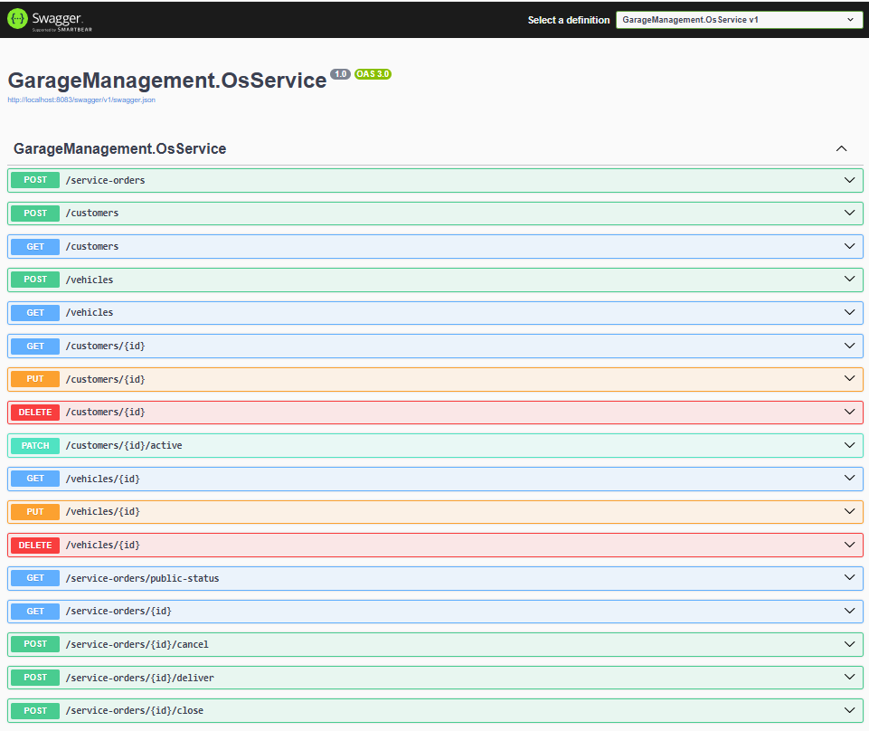

# OS Service

O OS Service é responsável pelo ciclo de vida da ordem de serviço e pelo
cadastro necessário para sua abertura:

- cadastro e consulta de clientes;
- cadastro e consulta de veículos;
- abertura, consulta, entrega, fechamento e cancelamento de OS;
- persistência da Outbox de eventos;
- orquestração da Saga entre Billing Service e Execution Service;
- compensação do orçamento quando uma etapa posterior falha.

Endpoints principais:

- `POST /customers`
- `POST /vehicles`
- `POST /service-orders`
- `GET /service-orders/{id}`
- `POST /service-orders/{id}/cancel`
- `POST /service-orders/{id}/deliver`
- `POST /service-orders/{id}/close`
- `GET /health`

O serviço publica eventos pelo RabbitMQ e consome `QuoteApproved`,
`PaymentApproved`, `PaymentRejected` e `ExecutionCompleted`.

## Documentação da Arquitetura do Service

Documentação:

- [Arquitetura dos microsserviços e da Saga](https://github.com/kmlyteixeira\garage-management-contracts\docs\saga-service-order-flow.md)

Fluxo resumido:

```text
OS Service
    |
    | POST /quotes
    v
Billing Service
    |
    | QuoteApproved / PaymentApproved / PaymentRejected
    v
RabbitMQ -> Saga no OS Service
    |
    | PaymentApproved
    v
Execution Service
    |
    | ExecutionCompleted
    v
OS = Finished -> Delivered -> Closed
```

Em caso de pagamento rejeitado ou falha ao criar a execução, a Saga chama
`POST /quotes/{serviceOrderId}/compensate`, aguarda a compensação e cancela a
OS. A Outbox permite retry da publicação dos eventos.

## Banco de Dados escolhido

[](#)

### Justificativa:

* [Open-source e amplamente utilizado](https://www.postgresql.org/about/)
* [Suporte a JSON (flexibilidade para evolução)](https://www.postgresql.org/docs/current/datatype-json.html)
* [Integração simples com Docker](https://hub.docker.com/_/postgres)

Tabelas principais: `service_orders`, `customers`, `vehicles` e
`outbox_messages`.

## Caminhos para Dockerfiles e manifestos Kubernetes

- Dockerfile: [Dockerfile](./Dockerfile)
- Manifestos Kubernetes: [k8s/](./k8s/)
- Deployment e Service: [k8s/deployment.yaml](./k8s/deployment.yaml)
- Kustomize: [k8s/kustomization.yaml](./k8s/kustomization.yaml)
- Infraestrutura Terraform: [infra/](./infra/)
- Compose E2E local: [docker-compose.e2e.local.yml](../docker-compose.e2e.local.yml)

## Evidência de cobertura de testes

Espaço reservado para inserir o print do SonarQube:

O projeto possui testes automatizados com foco nos **domínios críticos**.


Testes automatizados:

- [tests/](./tests/)
- [GarageManagement.OsService.Tests.csproj](./tests/GarageManagement.OsService.Tests.csproj)

## Swagger

Em execução local:

```text
http://localhost:8083/swagger
```

